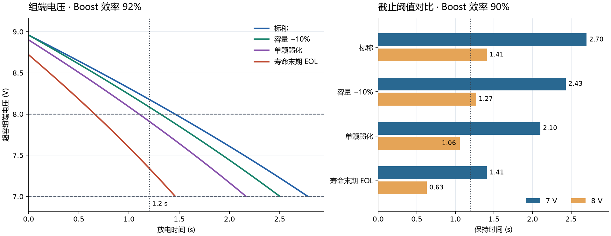

# DC V1.2 · 超级电容备电仿真

仿真日期：2026-11-20。输入：[原始 V1.2 仿真基线](../README.txt)。负载：12 W（12 V / 1 A 满载目标）。

**[仿真-行为]** 在压缩包采用的 **7.0 V 组端截止**下，12 组均满足 1.2 s，最差为寿命末期（EOL）＋90% Boost，保持 **1.410 s**，余量 **0.210 s**。若将截止提高到 **8.0 V** 作对照，只有 6/12 组达到 1.2 s；若以 1.0 s 作参考，则 9/12 组满足，三组 EOL 均不足 1.0 s。7.0 V 仍是本仓库的暂定值；1.2 s 为原数值模型的任务目标。

## 条件和测量

**[假设]** 四颗电容串联，初始开路电压 9.4 V，每颗从 2.35 V 开始。组端取电功率为 12 W 除以 Boost 效率和 99% 路径效率；扫 Boost 效率 90%、92%、95%。分别测量串联 ESR 之后的组端电压首次跌破 7.0 V 和 8.0 V 的时刻；单体门槛采用包内的 1.0 V，所有工况均先碰组端门槛。标称直流 ESR 75 mΩ/颗与 EOL 压力参数均为输入假设。

| 工况 | 每颗电容 / ESR | 7 V 保持时间，90% / 92% / 95% | 8 V 保持时间，90% / 92% / 95% |
|---|---|---:|---:|
| 标称 | 4 × (10 F / 75 mΩ) | 2.700 / 2.781 / 2.902 s | 1.408 / 1.458 / 1.533 s |
| 容量 −10% | 4 × (9 F / 75 mΩ) | 2.430 / 2.503 / 2.612 s | 1.267 / 1.312 / 1.379 s |
| 单颗弱化 | 1 × (6.3 F / 112.5 mΩ) + 3 × (9 F / 75 mΩ) | 2.100 / 2.166 / 2.264 s | 1.060 / 1.100 / 1.161 s |
| 寿命末期 EOL | 4 × (6.3 F / 112.5 mΩ) | 1.410 / 1.460 / 1.536 s | 0.628 / 0.659 / 0.705 s |

[12 组仿真结果 CSV](dc_v1_2_summary.csv)

最差工况（EOL、90%）在 **7 V 截止**模型下，1.2 s 时组端为 **7.285 V**、最低单体 **1.821 V**、组端电流 **1.849 A**；它在 **8 V 截止**时已提前退出，0.628 s 对应约 7.53 J。**[理论]** 固定该工况的 ESR、效率、负载及 9.4 V 初始电压，8 V 截止要保持 1.0 s，寿命末期有效电容至少约 **10.04 F/颗**；要保持 1.2 s 则至少约 **12.05 F/颗**。这是单变量临界值，未留余量，也不是元件标称值。

## 复现与边界

- 原包 [sweep.py](../sweep.py) 已重跑，[results.csv](../results.csv) 和四份波形 CSV 与原包逐字节一致。[原始 S01 网表](../S01_hold_behavioral.cir)默认是容量 −10%、Boost 92%；LTspice 在 7 V 测得 **2.502690546 s**，与 ngspice 一致。
- 12 份派生网表均用 LTspice 26.1.1 与 ngspice 46 批处理通过，并用恒功率 R-C 模型的解析积分核对截止时间。ngspice 与 Python 的 7 V 截止差最大约 **0.54 ms**，相当于原脚本的时间步。原 Python 每行的一部分电压数据有半毫秒的时间对齐偏差；附图使用 SPICE 时间戳。
- 仓库提供 [扫描脚本](run_hold_spice.py)，以及 EOL / 90% 工况的 [网表](eol_90_hold.cir)、[LTspice 日志](eol_90_ltspice.log) 和 [ngspice 日志](eol_90_ngspice.log)（LTspice 日志已移除本机路径）。复跑脚本会生成 12 份网表、测量日志及组端和单体波形。CSV 波形截至首次触及 7 V；8 V 截止由同一曲线的更早交点读取，此后的曲线只用于 7 V 情形。
- 复跑扫描：

  ~~~powershell
  py -3 sim/hold_validation/run_hold_spice.py --ngspice "C:/path/to/ngspice_con.exe" --original-results sim/results.csv --out "$env:TEMP/supercap-ups-hold-rerun"
  ~~~

- 包内 1.2 s 任务的理想化循环效率为 **75.54%–83.71%**，来自假设 95% Buck、0.5 A CC / 9.4 V CV 的 Python 能量模型。仿真没有模拟芯片开关、限流、输出纹波、主备切换或板级损耗，不能用来签收整机输出或效率。下一步可用拟采用的功率级网表，在 EOL 下检查 8 V 附近的实际 12 V 输出和截止行为。
