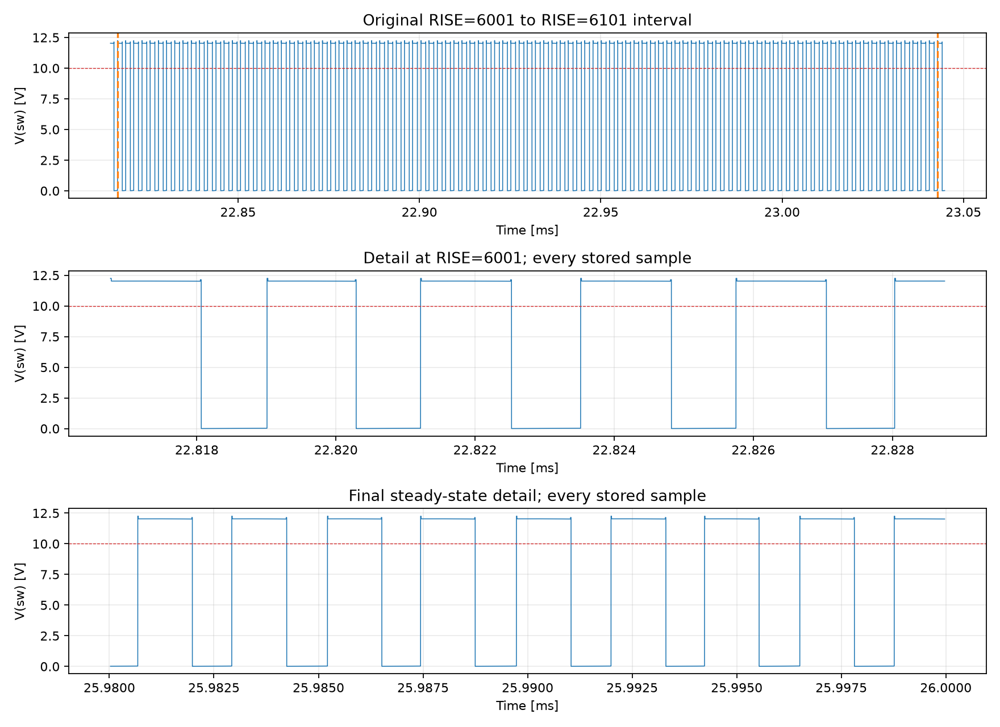
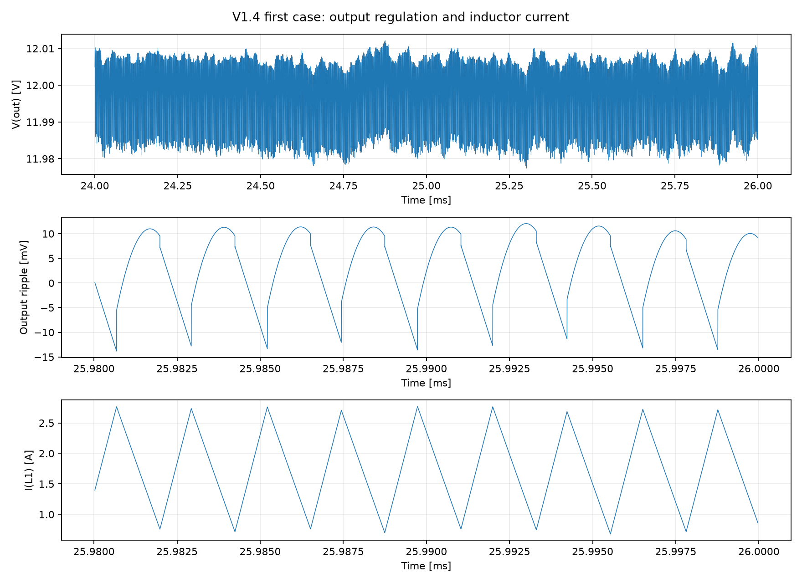
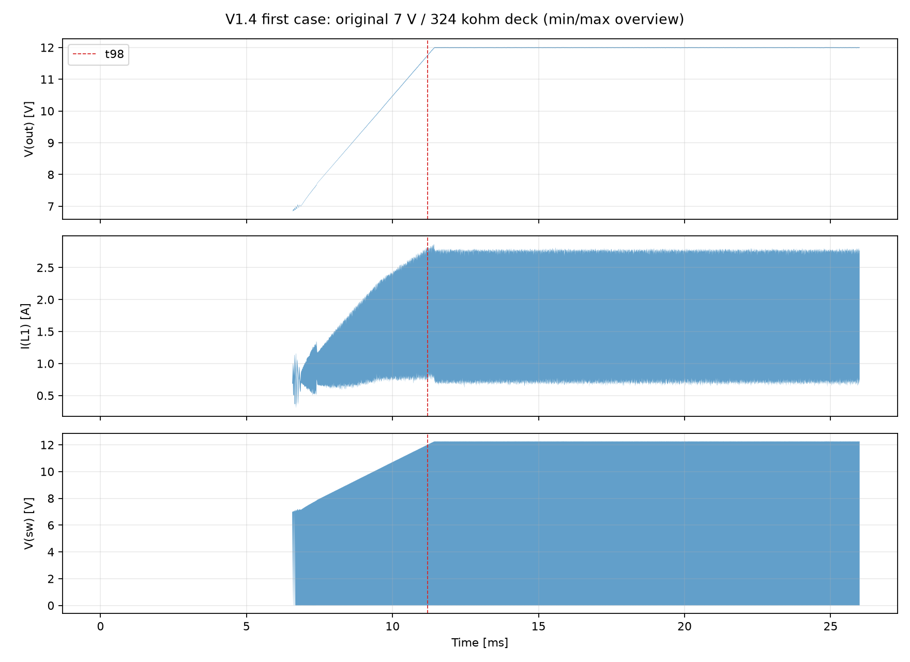

# V1.4 第一轮实际仿真验收：7 V / RFSW 324 kΩ

日期：2026-11-21（中国时间）。本轮只运行 `freq_vin7_rfsw324k.cir` 一次。
代码基线：`8bca353d8cc7301a6189c695c3d249d64da70247`，分支 `v1.4-audit-frequency-ilim`。

## 实验结论

LTspice 26.1.1 完成原始 26 ms 瞬态仿真，退出码 0，日志用时 218.421 s。按原始第 6001–6101 次 10 V 上升沿测得 **442.336492352 kHz**，相对于 496.137217379 kHz 理论值偏低 **53.800725027 kHz / 10.843920420%**。输出平均 **11.9987436854 V / 1 A**，24–26 ms 稳态纹波 **34.700593953 mVpp**，稳态电感峰值 **2.807664322 A**；0–26 ms 全程峰值 **2.864969670 A**。

模型在此工作点正常调压，稳态纹波通过 ≤100 mVpp 和 <50 mVpp 的目标。频率偏差存在于本次波形，尚未定位到唯一根因；不能用该单例认定 RFSW 无效，也不能宣称实际芯片工作频率已验证。原网表、模型、阈值、边沿序号、仿真时长和求解参数均未改动。

## 同步与生成器检查

开工时本地 `main` 无未提交修改。检查远程 PR #1 后，显式抓取并切换到 V1.4 分支；本地原抓取配置仅包含 `main`，已补充目标分支抓取和跟踪设置。切换完成后工作树干净，基线与 PR 头一致。

为保护已提交文件，把原 `scripts`、`netlists`、`data` 复制到工作区独立镜像，在镜像根运行原命令：

```powershell
py -3 sim/tps61088_v1_4/scripts/build_matrix.py
```

生成器退出码 0，生成 16 份网表；与 GitHub 已提交输入的比较结果为：

| 对比项目 | 实际结果 |
|---|---|
| 8 份 VIN=9.4 V 网表 | 原文件名和 SHA-256 完全一致 |
| 8 份 VIN=7 V 网表 | 脚本用 `vin7p0`，仓库用 `vin7`；仅文件名和首行案例名不同，归一后电路及测量逐行一致 |
| netlists/README.md | 脚本内较旧文本会覆盖仓库补充说明 |
| data/ti_ilim_screen.csv | 脚本会丢失已提交的 `minimum_headroom_pct` 列，其余数值相同 |
| 其余 data CSV | 内容一致；两个 EOL 表未被生成器改写 |

这是生成器与已提交命名/文档/表字段未同步的问题，不是电气参数变化。直接在已有目录生成会额外留下 8 份别名网表，形成 24 份 `.cir`，因此本轮保留源文件，未用生成物覆盖它们。**“16 份电路内容等效”通过，“生成器逐文件完全再现”未通过。** 证据见 [generator_comparison.csv](generator_comparison.csv)、[generator_readme.diff](generator_readme.diff)、[ti_ilim_screen.diff](ti_ilim_screen.diff) 和 [generator_stdout.txt](generator_stdout.txt)。本轮没有修订生成器或扩跑矩阵。

## 原始输入与运行前检查

原网表：[freq_vin7_rfsw324k.cir](../../netlists/freq_vin7_rfsw324k.cir)；运行输入字节副本：[input_deck.cir.txt](input_deck.cir.txt)。原网表 SHA-256 在运行前后均为 `1dcda7583c0bcf3d6a893ab50df044a7ab62ec26d7d832d33399d5b6e1a8ff0a`。

| 参数/接法 | 检查结果 |
|---|---|
| VIN / 目标输出 | 理想源 7 V，经 2 mΩ RS 到芯片 VIN；目标 12 V / 1 A |
| FSW | `RFSW fsw sw 324k`，正确连接 FSW 与 SW |
| ILIM | `RILIM ilim 0 100k`，接地 |
| MODE | 模型第 8 个端口为 `0`，FPWM |
| 电感 | `L1 vin sw 3.3u Rser=0.026`，无饱和磁芯模型 |
| 被动参数 | CIN 35 µF；COUT 47 µF / ESR 3 mΩ；反馈 1.076 MΩ / 120 kΩ；补偿 21.5 kΩ / 13 nF / 100 pF |
| 模型引用 | `../../tps61088_v1_3/model/TPS61088_LT.LIB`，实际日志确认装载 |
| 仿真 | Gear，reltol=0.003，trtol=7，gmin=1e-10，1线程，最大步长 50 ns，0–26 ms |

模型 21 个端口依次为 `AGND BOOT COMP EN FB FSW ILIM MODE NC_0 NC_1 PGND SS SW_0 SW_1 SW_2 SW_3 VCC VIN VOUT_0 VOUT_1 VOUT_2`，X1 逐端口匹配。4 个 SW 端并到 sw，3 个 VOUT 端并到 vout，AGND/PGND 均接地，NC 独立保留。

负载原式为 `min(max(V(load)/10,0),1)`：输出 ≥10 V 后恒为 1 A；低压启动段为 10 Ω 特性加限幅。因此本轮是满载稳态验证，不能描述成从 0 V 开始全程强制 1 A 的启动试验。

## 实际日志测量

以下数值直接来自 [LTspice 原始日志](ltspice_original.log)，机器可读表见 [measurements.csv](measurements.csv)。

| 原测量名 | 实际值 | 定义 |
|---|---:|---|
| t90 | 10.2964743364 ms | 第一次 VOUT 上穿 10.8 V，绝对仿真时间 |
| t98 | 11.2036638144 ms | 第一次 VOUT 上穿 11.76 V，绝对仿真时间 |
| sw_t6001 | 22.8167586943 ms | V(sw) 上穿 10 V，第 6001 次 |
| sw_t6101 | 23.0428309305 ms | V(sw) 上穿 10 V，第 6101 次 |
| f_sw_khz | 442.336492352 kHz | 100 周期除以两次边沿间隔 |
| avg_vout | 11.9987436854 V | 24–26 ms 时间平均 |
| ripple | 34.7005939526 mVpp | 24–26 ms 峰峰值 |
| peak_i | 2.80766432218 A | 24–26 ms 电感最大电流 |
| peak_start | 2.86496966994 A | 原定义实际覆盖整个 0–26 ms |
| iin_avg | 1.73443603801 A | 24–26 ms，源供电电流 |
| iout_avg | 1.00000000000 A | 24–26 ms，负载电流 |
| pin_avg | 12.1343888398 W | 芯片 VIN × 供电电流 |
| pout_avg | 11.9987436854 W | VOUT × 负载电流 |
| eta_pct | 98.8821426754% | 仅此模型窗口功率比 |

EN 在 100–101 µs 由 0 升到 3 V；原 t90/t98 没有减去 EN 时刻，本报告保留原始定义。全程电流峰值出现在约 11.416781 ms，接近软启动结束。

## 频率有效性与偏差定位

原验收时序成立：

```text
11.2036638144 ms < 22.8167586943 ms < 23.0428309305 ms < 26 ms
```

从本地完整 RAW 的 2,570,310 个点独立线性插值，得到第 6001/6101 边沿为 22.816758694293 / 23.042830930541 ms，与日志最大差约 4.1e-14 s。100 周期平均频率为 442.336492351641 kHz。原 10 V 阈值及边沿序号未调整。

边沿区间周期范围为 2.206788–2.322997 µs，均值 2.260722 µs，标准差 0.030196 µs。检查“低于 2 V 后才重新允许一次 10 V 上穿”的迟滞计数，频率窗口和 24–26 ms 窗口内均未发现额外重复 10 V 上穿。2/5/8/9/10/11 V 的独立交叉检查在 24–26 ms 均计得 884 个上升沿，频率约 442.16997 kHz。这些检查仅用于分析已有波形，没有替换原测量；24–26 ms 与规定 100 周期窗口的平均频率差约 0.038%。

V(ss) 第一次达到模型 SSEND 阈值 1.204 V 的时间为约 11.419235 ms，两次频率边沿均在其后。原模型内部存在约 301.811 kHz 的源，但它通过 `U5_EN_300K` 选择，`SSEND>0.5` 后被禁用；本次稳态实测也明显高于该源频率。该固定源不能作为稳态频偏的直接解释。

按 V1.4 已审计的 TI 数据手册 SLVSCM8D 第 7.3.3 节参数复算：

```text
f = 1 / (RFSW × 23 pF / 4 + 89 ns × VOUT/VIN)
  = 1 / (324000 × 23e-12 / 4 + 89e-9 × 12/7)
  = 496.137217379 kHz
偏差 = 100 × (442.336492352 / 496.137217379 − 1)
     = −10.843920420%
```

本轮排查已排除模型未装载、FSW 接错节点、MODE/引脚错接、启动早期计数和所检查窗口的明显振铃重复计数。7 V 源上的 2 mΩ 路径只造成约 3.47 mV 平均压降，不能解释 10.84% 频偏。模型以 FSW 电流参与定时，不能仅凭单点认定它忽略 RFSW。

**剩余根因未定**：需要下一轮区分模型时序/传播延迟近似与跨仿真器及数值求解差异。本轮没有修改步长/容差重跑，也没有运行 RFSW 对照，不能把任一候选原因写成已证实结论。TI 官方数据手册网络刷新本轮返回 404，本次公式采用当前分支已审计的 SLVSCM8D 参数进行代数复核；不把 TPS61088-Q1 文档替代本器件数据手册。







## 严格验收分类

| 分类 | 项目 | 证据与边界 |
|---|---|---|
| 已验证通过 | 模型装载、工作点求解、26 ms 瞬态完成 | exit 0，RAW 到 26 ms，原测量全部返回值 |
| 已验证通过 | 原规定频率测量时序与边沿可信性 | 时序成立；RAW 重算一致；所检查窗口未见振铃重复计数 |
| 已验证通过 | 模型内 12 V / 1 A 稳态工作 | 11.998744 V / 1 A，输出偏差约 −0.01047% |
| 已验证通过 | 稳态纹波 ≤100 mVpp，争取 <50 mVpp | 34.701 mVpp，限于本例模型及 24–26 ms 窗口 |
| 未通过 | 生成器逐文件完全再现 | 命名、README、CSV 字段三类差异；未覆盖原文件 |
| 仿真不收敛 | 本轮无此结果 | 日志有 5 条 N=0.0001 二极管警告，但求解及所有测量完成；警告仍保留 |
| 数据不足，无法判断 | 频偏是否在实际芯片及许可误差内 | 本例比理论值低 10.844%；未提供频率容差判据，不能自行增加“可接受”阈值；精确理论值本例没有达到 |
| 数据不足，无法判断 | 实际效率、热稳定性、电感饱和及限流安全 | 宏模型效率不能代替实物效率；L1 只有电感量与 DCR；未做过载/热态/重复性对照 |
| 数据不足，无法判断 | 其余 15 份网表、EOL 及 1.2 s 连续放电 | 本轮未运行，不从 V1.2 行为级结果外推通过 |

`eta_pct` 是芯片 VIN 到负载的宏模型功率比，不含外部 2 mΩ RS 损耗，也没有磁芯饱和、温升、PCB 寄生及电容 DC bias 模型。98.882% 不能作为实物采购效率保证。2.865 A 观察值也不能证明电感饱和安全或 100 kΩ 限流设置已获采购放行。

## 数据与复跑说明

原始 RAW 为 226,188,502 字节（约 215.7 MiB），已检查尺寸、时间终点和 SHA-256；与 OP RAW、DB 和原日志一起保留在本机 `work/v14-first-case-native/`，未加入 Git。完整 RAW 哈希和路径见 [environment.json](environment.json)。原模型真实 SHA-256 为 `418466fbd205f9e9ec487bee1d9c1ada48858ff49eef67767e84706966fa1795`。V1.3 compatibility.md 误把 `39f724...` 标为适配模型哈希；经本机实查它属于 TI ZIP 压缩包，本报告按真实文件记录，不改变模型内容。

| 已提交文件 | 内容 |
|---|---|
| [ltspice_original.log](ltspice_original.log) | LTspice 原始日志，字节未修改 |
| [environment.json](environment.json) | 工具/模型版本、命令、源码提交、输入/输出哈希及原生文件留存路径 |
| [measurements.csv](measurements.csv) | 全部指定测量、理论频率及偏差 |
| [frequency_edges.csv](frequency_edges.csv) | 第 6001–6101 次 10 V 上升沿逐沿时间 |
| [threshold_crosscheck.csv](threshold_crosscheck.csv)、[waveform_checks.json](waveform_checks.json) | RAW 独立交叉检查 |
| [frequency_window.csv.gz](frequency_window.csv.gz) | 规定频率窗口及前后 2 µs，所有存储点，含 V(sw)/V(out)/I(L1) |
| [steady_window.csv.gz](steady_window.csv.gz) | 24–26 ms 所有存储点，含 V(sw)/V(out)/I(L1) |
| [startup_peak_window.csv.gz](startup_peak_window.csv.gz) | 全程电流峰值前后各 10 µs，所有存储点 |
| [startup_envelope.csv](startup_envelope.csv) | 全程 4,000 组 min/max 包络；不是开关频率测量输入 |
| [raw_header.txt](raw_header.txt) | 原 RAW 头，含点数与变量 |
| [sha256_manifest.csv](sha256_manifest.csv) | 本结果目录各证据文件 SHA-256 与字节数（清单本身除外） |

波形 CSV.gz 使用 gzip 压缩，列名含单位。频率和稳态 CSV 保留所有原存储点；开关细节图采用全部窗口样本。全程总览采用 min/max 包络。

已运行的命令（从原网表目录执行；实际使用的绝对路径见环境记录）：

```powershell
& 'C:\Users\tortl\AppData\Local\Programs\ADI\LTspice\LTspice.exe' -b 'freq_vin7_rfsw324k.cir'
```

仅重新分析已有 RAW、不会启动仿真的命令（从仓库根执行）：

```powershell
py -3 sim/tps61088_v1_4/scripts/analyze_first_case.py --raw <本机保留的RAW绝对路径>
```

## 下一步建议与停点

先修正生成器的命名、README 写入策略与缺失字段，使它可无损再现；再按下一轮指令做 RFSW 对照或独立数值精度对照，检查实测频率是否随设定响应，并在 TI 原生 PSpice 环境交叉验证时序。每次只改变一个因素，保留原阈值和原始失败记录。此处仅提出建议，未执行后续仿真。

本轮不合并 main、不冻结 BOM、不改变架构。第一份频率基准的实际仿真、证据保存及结果报告已完成，后续研发等待下一轮指令。
