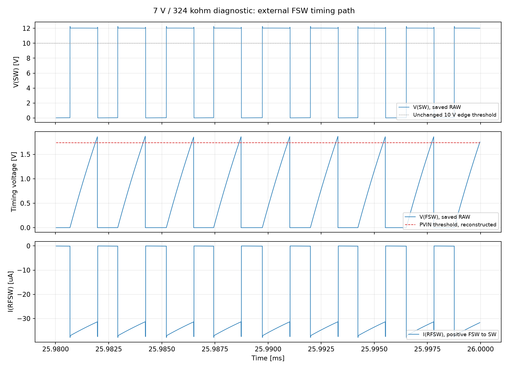
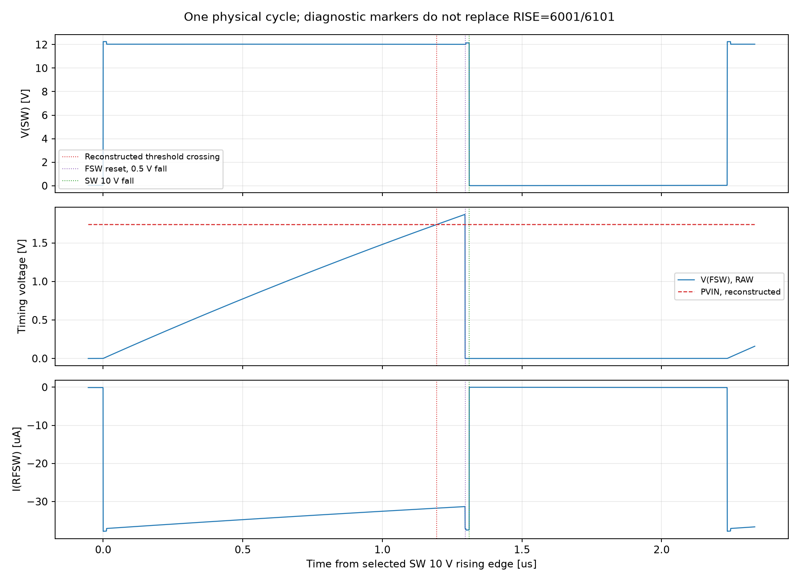

# V1.4 第二轮：FSW 定时路径独立诊断

## 结论与证据等级

本次诊断实测存在明显的 FSW 正向斜坡及正的时间平均值。公开宏模型中，FSW 通过 RFSW 对内部 23pF 电容充电，复位开关的关断电阻为 1MΩ。保存的电压、电流及充电积分与这一路径吻合。它为负频偏提供了可核算的机制，并与四组参数的负偏差趋势一致。**目前还不能把第一轮全部 −10.844% 频偏唯一归因于该路径，也不能据此认定 TI 模型存在缺陷。**

这是 TI 宏模型在 LTspice 中执行的证据，不是对实物芯片内部波形或实际效率的验证。本报告只读取已经完成的 RAW、原始日志和已有 LIB，未更改电气参数、求解器、仿真时长或边沿序号。

## 运行与原测量复现

诊断网表为 `diagnostics/freq_vin7_rfsw324k_fsw_probe.cir`；输入7V、RFSW324kΩ、MODE接地、RILIM100kΩ、3.3µH/26mΩ电感。原始日志退出成功，仿真至26ms。原定频率测量仍为SW=10V、RISE=6001与6101。

日志中的 `t98=11.2036638144ms < sw_t6001=22.8167586943ms < sw_t6101=23.0428309305ms < 26ms`，频率 `442.336492352kHz`。这些结果与第一轮相同，额外保存 FSW 与 RFSW 电流没有改变该次原测量结果。

## FSW 偏置、电流方向与有效关系

24–26ms 的权威均值采用原始 LTspice 日志；独立积分用于交叉核对。独立积分对24ms及26ms端点插值，和日志的FSW均值相差不到0.3µV、电阻电流均值相差不到0.001nA；保留各自数值来源，不把端点处理差异认定为异常。

| 量 | 结果 |
| --- | --- |
| V(FSW)最小/最大 | -9.81019421e-05V / 1.89360578V |
| V(FSW)时间平均 | 0.551986902541V |
| I(RFSW)时间平均 | -19.7566214073µA |
| I(RFSW)最小/最大，RAW | -37.819812 / -0.022012316µA |
| I(RFSW)峰峰值，日志 | 37.79779953µA |
| 欧姆定律最大绝对残差，RAW | 6.78e-21A |

`RFSW fsw sw 324k` 定义电阻正电流方向为 FSW→SW，所以实际充电电流是 `−I(RFSW)`。内部零伏检测源与1Ω跨阻源使 `V(U5_IFSW,AGND)=−I(RFSW)×1Ω`，并使 FSW 与电容节点 U5_N01584 等电位。

外部波形满足 `I(RFSW)=[V(FSW)−V(SW)]/324kΩ`。只在稳定SW高相且电流远离零时，才可写有效定时关系 `V(SW)/[−I(RFSW)]=324kΩ×V(SW)/[V(SW)−V(FSW)]`。该量随斜坡变化，不是常数。排除每个高相两端30ns后，保存样本范围约325.355–383.540kΩ。不能跨低相、复位或过零点平均该比值后，直接把它当作新的固定RFSW。

## 公开宏模型的实际定时路径

`C_U5_C1=23pF`；`OFF_TIMER_U5_S1` 在 GATE_L 有效时复位，Ron=1mΩ，关断时 Roff=1MΩ。高相期间：

`23pF·dV(FSW)/dt=−I(RFSW)−V(FSW)/1MΩ`。

对883个完整稳态高相，排除两端各30ns，对净充电电流积分再除以FSW电压增量，得到的等效C均值为 **22.99975340pF**，范围22.99973804–22.99987652pF。它验证了已保存电压/电流与23pF及1MΩ支路的一致性，不是额外拟合出的器件参数。

MODE接地使 MODE_OK=0、U5_TOFF_SEL=0，U5_TEND 选择 U5_TOFF。主要路径是FSW斜坡与U5_PVIN比较，再经过90ns等效RC及逻辑/驱动到SW下降。E_U5_ABM9计算的动态VSW/IFSW参与其他选择/定时逻辑；它的一个平均值不能直接视作当前模式的周期公式。SSEND置位后，固定约301.811kHz启动时钟不再直接决定稳态周期。

正常稳态下，`U5_ON=IF(VREF < FB−50mV,1,0)`。由保存的SS及输出反馈比值检查，该条件距置位最小还有48.770mV，因此重建时取U5_ON=0。此时S2/S3各以1GΩ关断电阻并联对应3MΩ支路。使用两个5pF电容、2.4MΩ/800kΩ SW分压及保存SW波形，按原参数积分重建PVIN阈值，丢弃起始至少1ms历史。

重建PVIN范围 **1.73629345–1.73938716V**，越阈值时均值1.73768969V。它是基于公开网络的重建值，**没有直接保存内部PVIN节点**。外部SW与内部SW之间还有四个并联1mΩ引脚电阻，这也是重建的限制。

| 逐周期时间量，24–26ms，883个完整周期 | 均值 | 标准差 |
| --- | --- | --- |
| SW 10V上升→FSW越过重建PVIN | 1194.621ns | 0.292ns |
| 越过重建PVIN→FSW复位0.5V下降 | 95.989ns | 8.446ns |
| FSW复位0.5V下降→SW 10V下降 | 14.480ns | 0.115ns |
| SW 10V高相宽度 | 1305.090ns | 8.474ns |

旧分析使用固定23pF、324kΩ、1MΩ、每周期重建阈值和保存的SW高相平均值预测RC斜坡时间，预测减去实际斜坡时间的均值为-0.100ns，范围-0.126–-0.010ns。这个结果只说明“平均SW电压近似”下RC网络与重建波形相容，不是完整时变输入ODE的最终误差界。现有 `analyze_fsw_internal.py` 已升级为使用实测SW(t)分段线性波形，对 `C·dV/dt=(VSW−VFSW)/RFSW−VFSW/1MΩ` 逐段精确积分，并用直接保存的U5_PVIN动态阈值提取预测交点；新算法尚未对任何内部探针RAW运行，因此目前没有新的斜坡残差结果。

图中阈值交点和复位标记仅用于诊断分解，不替代原RISE=6001/6101测量。FSW先复位，再出现SW的10V下降，所以SW下降瞬间读取FSW电压不能当作比较器阈值。

## 频偏贡献的数值预算及边界

TI给定线性公式为 `T=RFSW·23pF/4+89ns·VOUT/VIN`。固定VIN=7V、VOUT=12V时，线性斜坡时间为1.086750000µs，总周期2.015571429µs，即496.137217379kHz。

若只计充电电阻上的FSW电压，斜坡应为 `−R·C·ln(1−VTH/VSW)`。再计1MΩ关断支路，`Req=R||1MΩ`、`V∞=VSW·1MΩ/(R+1MΩ)`、`tramp=−Req·C·ln(1−VTH/V∞)`。取VTH=VIN/4，仅作简化近似：

| 近似层次 | 估算周期 | 估算频率 |
| --- | --- | --- |
| 数据手册线性RC+89ns | 2.015571429µs | 496.137217kHz |
| 指数充电，无漏支路+89ns | 2.166258672µs | 461.625388kHz |
| 指数充电，含1MΩ支路+89ns | 2.222550608µs | 449.933512kHz |
| 原6001/6101实际测量 | 2.260722362µs | 442.336492352kHz |

相对线性式，实际多出245.151ns周期。无漏支路指数式增加150.687ns，1MΩ支路再增加56.292ns，仍剩38.172ns。这个预算表明候选机制具有足够量级，但理想占空比、固定7/12V、固定89ns均为简化；**不能把各项数字等同于严格的独立因果占比，也不能宣称剩余已闭环。**

四组对照趋势如下。低频两组原6001/6101失败，表中的RAW辅助值只提供稳态频率信息，不改变原测量失败判定。不同测量窗口亦不得当作同一统计量。

| VIN/V | RFSW/kΩ | 理论/kHz | 含1MΩ RC近似/kHz | 实际对照/kHz | 实际来源 |
| --- | --- | --- | --- | --- | --- |
| 7 | 324 | 496.137 | 449.934 | 442.336 | 原6001/6101日志 |
| 7 | 510 | 324.142 | 288.611 | 286.243 | 24–26ms RAW辅助值；原固定索引失败 |
| 9.4 | 324 | 505.915 | 440.498 | 435.035 | 原6001/6101日志 |
| 9.4 | 517 | 324.006 | 274.646 | 273.055 | 24–26ms RAW辅助值；原固定索引失败 |

三组新对照与RC假设预测的负偏差趋势相容；9.4V/324kΩ原窗口实际435.034828kHz低于7V/324kΩ的442.336492352kHz，和理论公式的小幅上升相反。尚未用直接内部PVIN/TOFF/GATE_L波形及独立求解条件完成排他验证，因此保留“待验证机制”结论。

## 保留文件与下一步

`fsw_analysis.json` 为机器可读独立检查，`fsw_cycle_analysis.csv` 保留883个周期的明细，两个PNG保留有效外部波形与重建阈值。完整267,313,580字节RAW由父任务在本地归档，不在本报告流程上传GitHub。工作目录保留的脚本`analyze_fsw.py`与`make_fsw_report.py`只读取现有结果。JSON中有效定时电阻的统计按保存样本计算；由于LTspice自适应采样，其mean不代表时间平均，本报告只引用样本范围。

后续审查可优先决定是否增加内部U5_PVIN、U5_TOFF、GATE_L、SSEND的只读保存，以及保持原始网表独立不变的求解步长敏感性对照，用于区分90ns路径、驱动延迟和事件离散误差。此次未启动这些额外仿真，也未运行限流矩阵、合并main或冻结BOM。

本次实际使用的两份脚本以 fsw_analysis_source.py.txt 和 fsw_render_source.py.txt 原样归档，其中路径绑定本次 scratch 环境，不是通用命令入口。重建阈值的完整 NPZ 缓存约 8 MB 留在本地 work/v14-round2-timing-review；仓库保存实际外部 FSW/RFSW 全采样窗口、逐周期 CSV、重建统计和图，避免重复提交该缓存。JSON 中的独立积分端点支持与日志全窗 AVG 略有差异，均值验收采用原日志；这不改变偏置或定时结论。

## 补充推导：剩余频偏更像是比较器之后的有效延迟（仅基于既有数据）

本节没有使用新仿真数据，是对本报告已有 883 个周期统计和公开 LIB 网络的进一步分解。它把下一轮实验重点从“继续拟合 23pF 斜坡”转向“直接检查比较器之后的延迟链”。

已有逐周期统计：

| 时间段 | 均值 |
| --- | ---: |
| SW 10V 上升 → 重建 PVIN 阈值交点 | 1194.621 ns |
| PVIN 阈值交点 → FSW 电容下降穿过 0.5V | 95.989 ns |
| FSW 电容穿过 0.5V → SW 10V 下降 | 14.480 ns |
| PVIN 阈值交点 → SW 10V 下降 | **110.469 ns** |

因此，SW 高电平持续时间约为 1194.621 + 110.469 = 1305.090 ns，与原逐周期统计一致。旧版平均SW电压近似的23pF / 1MΩ斜坡模型预测误差均值约−0.100ns，支持该网络具有解释力，但该残差不能当作严格的时变输入ODE误差界。下一轮应以升级后的实测SW(t)积分结果复核；在新RAW结果产生前，不能把斜坡误差视为已完全排除。

进一步检查同一 LIB：

- R_U5_R9 = {90/0.693} Ω ≈ 129.870 Ω，连接比较器输出 U5_N16903113 与 U5_TOFF；
- C_U5_C7 = 1 nF，从 U5_TOFF 接至 AGND；
- `COMP_BASIC_GEN` 的输出并非理想零阻抗节点：其行为源 `Yint` 经 `R1=1Ω` 驱动输出节点 `U5_N16903113`，该节点还有 `C1=1nF` 对地；它再经 `R_U5_R9=129.870Ω` 驱动 `C_U5_C7=1nF`。对这个两节点RC梯形网络，`H(s)=U5_TOFF(s)/Uideal(s)=1/[1+s(R1C1+R1C7+R9C7)+s²R1R9C1C7]`。在比较器行为源理想阶跃、初始电容为0的假设下，U5_TOFF达到0.5的计算时间约 **91.714 ns**；此前只用`0.693·R9·C7=90.019ns`的单极点估算忽略了比较器输出端的1Ω/1nF网络，低估约1.694ns。该计算仍不是实测U5_TOFF延迟，更不是硅片传播延迟；
- 既有诊断指出 MODE=0 时 U5_TOFF_SEL=0，U5_TEND 选择 U5_TOFF。

这给出一个值得直接验证的链路假设：比较器交点之后，1nF 延迟网络约 90ns，再叠加比较器/逻辑/驱动传播，最终到 SW 下降的总时间约 110.469ns。注意：目前还没有直接保存这些内部节点，不能把各段延迟精确分摊，也不能确认数据手册的 89ns 定义与本报告的“PVIN 交点至 SW 下降”完全同一测量边界。

数值交叉检查：

- 原 6001/6101 测得周期：2260.722362 ns；
- 简化的 23pF 指数充电 + 1MΩ 漏支路 + 数据手册 89ns 延迟模型：2222.550608 ns；
- 剩余周期差：**38.171754 ns**；
- 既有周期统计的比较器阈值交点至 SW 下降为 110.468850 ns，比 89ns 多 21.468850 ns；
- 若按数据手册周期公式中的 VOUT/VIN = 12/7 比例换算，这个延迟差对应 **36.803742 ns** 周期差；
- 与 38.171754 ns 的剩余量仅相差 **1.368012 ns**。

这是较强的数量级与比例一致性证据，支持“剩余频偏主要来自比较器之后的有效延迟链”这一新假设。但它仍不是因果证明：两个时间量来自不同的简化边界，89ns 是否与重建的阈值交点严格对应，必须用直接内部波形确认。

### 下一轮优先判别

直接保存 X1:U5_PVIN、X1:U5_N01584、X1:U5_N16903113、X1:U5_TOFF、X1:U5_TEND、X1:GATE_L 和 X1:U5_TDELAY_SW，逐周期测量：

1. 电容与 PVIN 比较器的实际交点；
2. 比较器输出 U5_N16903113 翻转时刻；
3. U5_TOFF 穿越 0.5V 的时刻；
4. GATE_L 翻转时刻；
5. SW 10V 下降时刻。

再比较 50ns 与 25ns Gear 最大步长。若 U5_TOFF 的 50% 交点约为比较器翻转后 90ns，而 SW 下降稳定落后于该交点约 14–20ns，则延迟链假设得到支持；若这些事件随最大步长显著漂移，则应先处理数值敏感性。

本补充只是对已有结果的推导，不代表新仿真已运行。直接内部节点探针及分析脚本已准备在 sim/tps61088_v1_4/diagnostics/ 与 sim/tps61088_v1_4/scripts/analyze_fsw_internal.py，等待 LTspice 执行和 RAW 验证。

### 对 89ns 参数映射的边界说明

TI Rev. D 第 7.3.3 节只把 t_DELAY=89ns 定义为频率设定方程中的参数；第 7.4.1 节描述的是自适应恒定关断时间控制序列。数据手册没有把 t_DELAY 明确定义成“本报告重建的 PVIN 交点到外部 SW 下降沿”这一具体测量边界。因此，上述 110.469ns 与 89ns 的差值及 VOUT/VIN 换算，只能作为有效延迟假设的数量级核对，不能视为直接测得的芯片 t_DELAY 偏差。

此外，旧的90.019ns计算把比较器输出视作理想电压源，忽略了 `COMP_BASIC_GEN` 内的1Ω串联电阻和1nF输出电容。纳入该输出网络后，U5_TOFF的理想阶跃50%交点计算值约91.714ns。该数值仍只属于宏模型电路的解析推导，不是仿真测量，更不是实物芯片参数。必须以新增RAW中的U5_N16903113、U5_TOFF、U5_TEND、GATE_L和SW实际交点分摊比较器输出网络、逻辑与驱动延迟。

