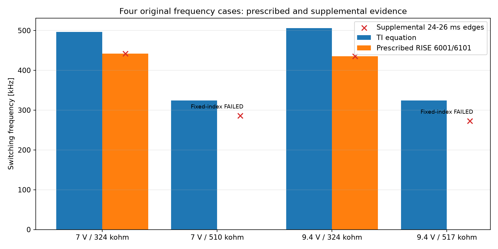
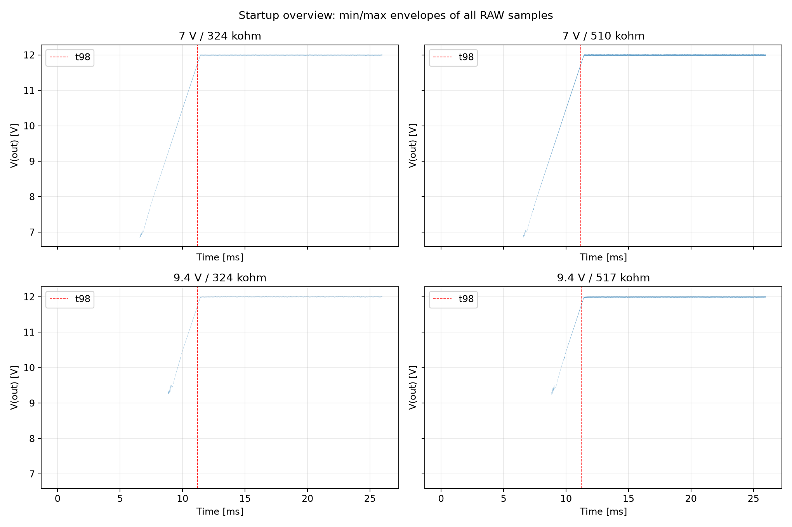
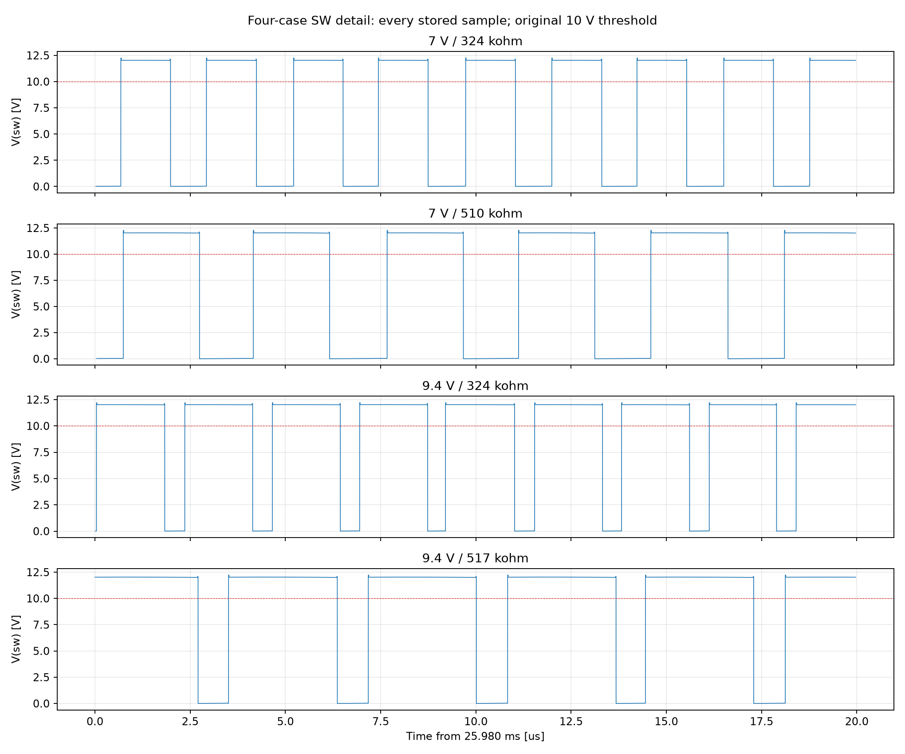
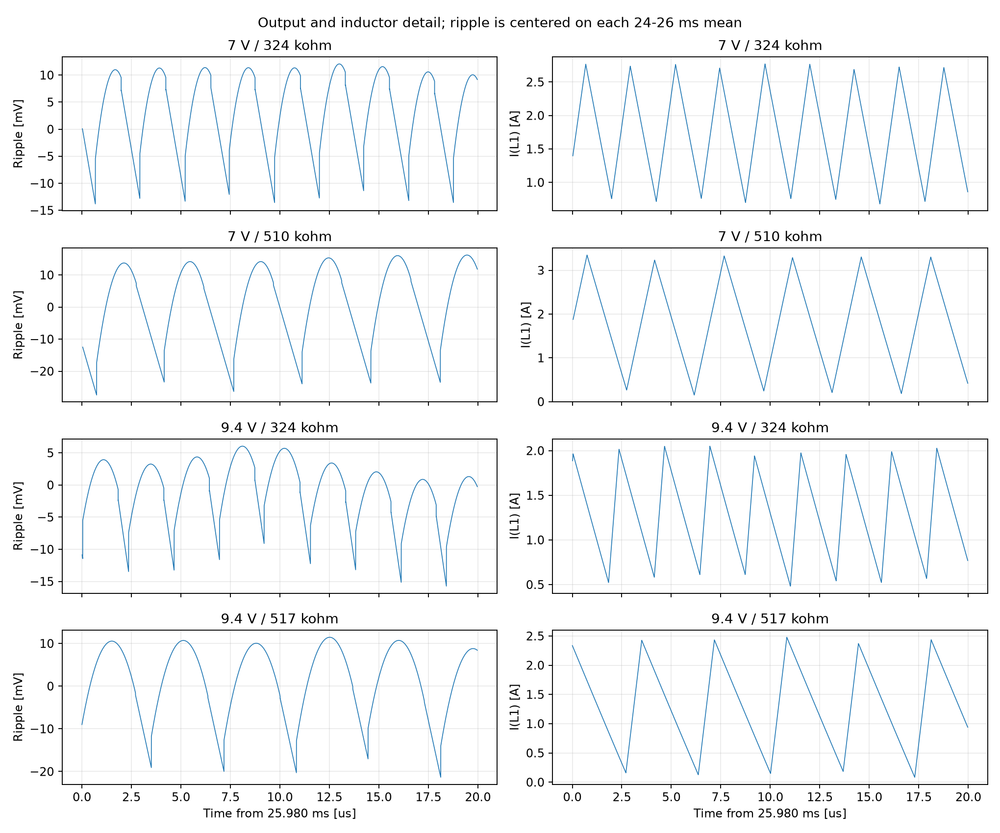

# V1.4 第二轮频率对照与 FSW 定时路径实验报告

日期：2026-11-21（Asia/Shanghai）。分支：v1.4-audit-frequency-ilim。

## 结论与范围

本轮按指定顺序实际运行三份频率对照网表及一份 FSW 探针网表，四次均完成 26 ms 瞬态，进程退出码为 0。没有更改元件值、求解器、时长、10 V 阈值或 RISE=6001/6101；没有运行限流矩阵。首轮 7 V / 324 kΩ 原始证据保留不变，用于四组对照。

**两份低频网表的规定频率测量失败，不能标为整案通过。** 原因是启动期间 SW 不一定跨过 10 V，而 26 ms 内总穿越数不足 6001/6101。独立 24–26 ms 频率只作为补充列。所有四组在该稳态窗内约 12 V / 1 A、纹波低于 100 mVpp；7 V / 510 kΩ 的 52.444 mVpp 未达到“争取低于 50 mVpp”。

FSW 探针重现了首轮 442.336492 kHz。全部共有 RAW 向量（包括时间）逐个存储点、逐个 double 完全相同，支持该频偏在相同环境下可重复；这不是统计容差验证或实物验证。官方两个包的 LIB 统一换行后相同，未发现版本内容差异。

## 1. 同步与方法

同步前工作区干净，分支从 9811c5e 快进到 f24cf8e72681097c2e148064ddd3cb6ca5f1704c。运行指定 unittest 命令，3 项通过；记录见 unit_tests_before.log。session_environment.json 的 source_worktree_status 是建立结果目录和运行测试后的状态，因此会显示结果目录及测试缓存，不代表同步前已有未提交源码。

环境与首轮相同：LTspice 26.1.1.0（可执行文件 SHA-256 3c144a2b3ec6a30baac6761c502d99b95aaa40b947ff5eca25b8fbd80d68af72）、Normal solver、Gear、reltol=.003、trtol=7、gmin=1e-10、单线程、plotwinsize=0、26 ms / 最大 50 ns。模型 TPS61088_LT.LIB 的 SHA-256 为 418466fbd205f9e9ec487bee1d9c1ada48858ff49eef67767e84706966fa1795。

运行顺序：7 V / 510 kΩ → 9.4 V / 324 kΩ → 9.4 V / 517 kΩ → 7 V / 324 kΩ FSW probe。L1=3.3 µH、DCR=26 mΩ，RILIM=100 kΩ，MODE=0，其他被动件均保持输入网表值。BLOAD=min(max(V(load)/10,0),1)，达到 10 V 后为 1 A；启动低压期间不是恒定 1 A。

每例目录保存输入字节副本、原始日志、退出状态和模型/网表/本地 RAW 哈希。四次原日志各有 5 条 N=0.0001 二极管警告，均原样保留。完整 RAW 的字节数、点数和 26 ms 终点已检查；未见 time-step-too-small 或 fatal error。仅有测量 FAIL 不能判为求解不收敛。

## 2. 频率对照

理论值使用用户给定条件对应的 TI 方程：f=1/(RFSW·23 pF/4+89 ns·12/VIN)。表中用未舍入的计算值比较，约为用户给出的 324.142、505.915、324.006 kHz。

| VIN/V | RFSW/kΩ | 理论/kHz | 原规定频率/kHz | 原规定偏差 | 补充 24–26 ms/kHz | 补充偏差 |
|---:|---:|---:|---:|---:|---:|---:|
| 7 | 324 | 496.137217 | 442.336492 | -10.843920% | 442.169970 | -10.877484% |
| 7 | 510 | 324.141604 | FAIL（不足规定边沿） | — | 286.243263 | -11.691909% |
| 9.4 | 324 | 505.914899 | 435.034828 | -14.010276% | 435.632352 | -13.892168% |
| 9.4 | 517 | 324.005536 | FAIL（不足规定边沿） | — | 273.054627 | -15.725320% |

规定频率来自 LTspice 日志的 100 个周期；补充频率来自完整 RAW 中 24–26 ms 所有 10 V 上升沿的首尾跨度，未修改或替代原 .meas。两种窗口不同，因周期抖动会有小差异。可下载 [CSV](frequency_comparison.csv)；每例另有 measurements.csv、all_10V_rising_edges.csv 和 threshold_crosscheck.csv。

在相同 324 kΩ 下提高 VIN，理论频率小幅增加，而本次宏模型频率降低。在两组约 324 kHz 的理论设定下，补充实测分别 286.243 与 273.055 kHz，后者更低。该趋势与 FSW 有限斜坡及漏支路的诊断假设一致，但不构成唯一根因证明。

## 3. 测量时序与输出

| VIN/V / RFSW/kΩ | t98/ms | sw_t6001/ms | sw_t6101/ms | 全程 10 V 上升沿数 | 判断 |
|---|---:|---:|---:|---:|---|
| 7 / 324 | 11.203663814 | 22.816758694 | 23.042830930 | 7408 | 时序通过 |
| 7 / 510 | 11.196657784 | FAIL | FAIL | 4790 | 数据不足，规定测量失败 |
| 9.4 / 324 | 11.208990522 | 23.388219743 | 23.618086397 | 7138 | 时序通过 |
| 9.4 / 517 | 11.214535348 | FAIL | FAIL | 4515 | 数据不足，规定测量失败 |

t90/t98 均为从仿真零时刻起算的绝对时间，未扣除 EN 的约 101 µs 上升时刻。每例完整 t90 见原日志/测量 CSV。软启动 SS=1.204 V 穿越约 11.419235 ms；有效固定频率测量及补充稳态窗都在其后。

各例 2/5/8/9/10/11 V 阈值在 24–26 ms 的边沿数一致；补充窗及有效规定窗内均未发现未降回 2 V 就再次上穿 10 V 的重复计数。有效规定边沿的 RAW 插值与日志误差小于 0.1 ps，支持计数读取正确；不能把这种输出精度解释为物理计时精度。

| VIN/V / RFSW/kΩ | 平均 VOUT/V | IOUT/A | 纹波/mVpp | 电感稳态/全程峰值 A | 模型功率比/% |
|---|---:|---:|---:|---:|---:|
| 7 / 324 | 11.998743685 | 1 | 34.700594 | 2.807664 / 2.864970 | 98.882143 |
| 7 / 510 | 11.998842988 | 1 | 52.444163 | 3.365614 / 3.421604 | 98.732452 |
| 9.4 / 324 | 11.998858693 | 1 | 30.543029 | 2.102094 / 2.130912 | 99.390651 |
| 9.4 / 517 | 11.998914508 | 1 | 47.722928 | 2.542287 / 2.547794 | 99.291453 |

统计窗为 24–26 ms；peak_start 名称下的原测量实际覆盖整个 0–26 ms。模型功率比按 -V(vin)·I(V1) 和 V(vout)·I(VLOAD) 计算，排除上游 2 mΩ 源电阻压降损耗，不是台架效率。电感模型仅有 L 与 DCR，无法验证饱和、磁芯损耗或热安全。

## 4. FSW 定时路径与官方包

探针原日志：VFSW 平均 0.551986903 V，范围 -0.098102 mV 至 1.893605775 V；I(RFSW) 平均 -19.756621 µA，峰峰 37.797800 µA。它是随开关周期充电/复位的斜坡，不能把平均偏置视作恒定直流值。

电流正方向定义为 FSW→SW，所以充电时 I(RFSW) 为负；I=(VFSW−VSW)/324 kΩ 的 RAW 最大残差约 6.78e-21 A。内部 0 V 检测源的方向与外部电阻电流相反。仅在高相非过零区可计算 VSW/[-I(RFSW)]；不能用跨周期平均比值解释精确频率。

详细的 23 pF 斜坡、1 MΩ 复位关断支路、阈值重建与延迟贡献见 [FSW 定时路径分析](FSW定时路径分析.md)。内部阈值/逻辑节点未直接保存，RC 重建和公式分解都是有条件诊断，不能据此提前认定模型有缺陷。

本次实际取得 SLVMDA9、SLVMAU6A Rev. A 官方 ZIP：两包 LIB 仅换行不同，统一后全部 439 行及 27 个子电路相同；两包内部都是 Final 1.00 / 11MAY2015。仓库模型可由新下载 LIB 仅做两处已记录化简逐字节重建。详见 [模型版本报告](model_binary/model_version_comparison_zh.md)。产品页本轮 HTTP 404、官方 ZIP 下载 HTTP 200 的区别也已原样记录。没有用 Q1 模型替代。

## 5. 严格验收状态

| 项目 | 状态 | 依据 |
|---|---|---|
| 四次本轮瞬态求解 | 已验证完成 | 退出 0、Normal/Gear、完整 26 ms RAW、原日志 |
| 9.4 V / 324 kΩ 规定频率时序 | 已验证通过 | t98 < 23.388220 < 23.618086 < 26 ms |
| 7 V / 510 kΩ、9.4 V / 517 kΩ 规定频率测量 | 未通过；数据不足以按该测量验收 | 原 .meas FAIL，全程仅 4790 / 4515 沿 |
| 四组稳态约 12 V / 1 A，纹波 ≤100 mVpp | 已验证通过（宏模型范围） | 日志与 RAW 交叉核验 |
| 7 V / 510 kΩ 纹波争取 <50 mVpp | 未达到 | 52.444 mVpp |
| 原频偏重复性 | 已验证（相同模型与数值设置） | probe 与首轮共有向量逐点完全一致 |
| 原频偏唯一根因/模型缺陷定性 | 数据不足，无法判断 | 只有外部探针、条件化重建，缺少内部节点/求解器对照 |
| 两个官方包 LIB 内容差异 | 已完成二进制审计 | 仅换行不同；子电路相同 |
| 仿真不收敛 | 本轮未出现 | 测量失败与求解完成分开记录 |
| 实物效率、磁芯饱和、1.2 s连续备电、BOM冻结 | 未验证/本轮不执行 | 超出本轮指定范围 |

## 6. 文件与复核

四张对照图：

每例 steady_window.csv.gz 与 switching_detail.csv.gz 保留所选时间窗的每个存储采样点；startup_envelope.csv 为逐段 min/max 包络，避免均匀抽点丢失峰值。全程每个 10 V 上升沿另存 CSV。完整 RAW、OP.RAW、DB 及原生 LOG 位于本地，路径/字节/哈希见 native_files_local_inventory.csv；未上传 RAW。baseline_probe_reproducibility.json 记录首轮与探针共有向量的逐点比较。manifest_sha256.json 覆盖本目录其余材料。

在仓库根目录复现 RAW 后处理（不会启动仿真）：

    py -3 sim/tps61088_v1_4/scripts/analyze_frequency_round2.py --native-root <本地四例目录> --first-raw <首轮完整RAW>

仿真器实际调用、原 runner 源码与后处理日志均保留。首轮 first_case 目录、所有 .cir 和 TPS61088_LT.LIB 与 f24cf8e 相比没有改动。提交仅面向当前 V1.4 分支；GitHub 文件在推送后以提交归档逐字节核验。

## 7. 供审查的下一步建议

本轮结束后暂停。建议下一轮先审查低频案例的采集时长：维持原边沿序号，另建明确版本化的较长采集方案（例如 35–40 ms，需重新校验实际时序），不改写本次失败记录。之后才考虑增加内部定时节点探针、原生 PSpice 对照及数值敏感性试验，逐项分离阈值、RC、延迟与求解器影响。

7 V 降频后电流峰值和纹波明显增加，应作为采购选型的待解决风险，不能仅按理论频率选电感。模型功率比接近 99% 也不能据此冻结效率承诺。等待本轮审查，不合并 main、不冻结 BOM、不启动限流矩阵。
