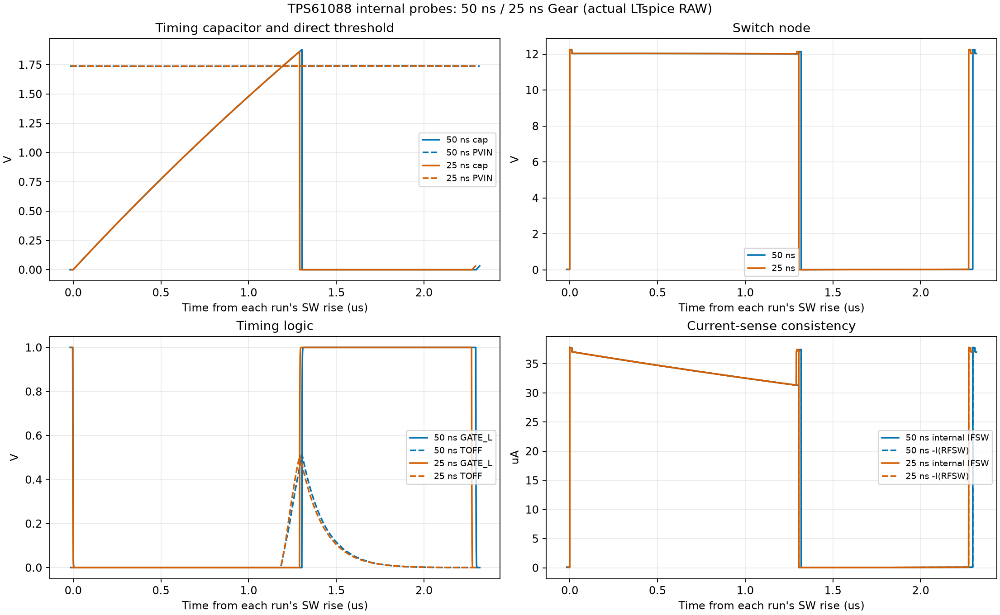

# V1.4 内部 FSW 探针 50 ns / 25 ns 实际仿真实验报告

日期：2026-11-21。源码起点：`ef1ba6702bce0dfb668501c733e8acaf4ae73abb`；分支：`v1.4-audit-frequency-ilim`。

## 1. 结论与验收边界

两份指定网表均已在本机 LTspice 实际求解到 26 ms，进程退出码为 0；两条指定 Python 分析命令最终也均退出 0。50 ns 内部探针的原规定频率为 **442.336492352 kHz**，与原始基线全部 11 个共有 RAW 向量（含时间和 L1:flux）的 2,570,310 个 double 采样逐点一致，最大差为 0，见 [逐点复现检查](internal_probe_baseline_equality_50ns.json)。25 ns 为 **441.757819237 kHz**，相对 50 ns 改变 **−0.578673115 kHz / −0.130821925%**。

两次稳态输出均约 11.9987 V / 1 A，纹波分别 34.7006 / 29.5726 mVpp。原规定测量满足 `t98 < sw_t6001 < sw_t6101 < 26 ms`。对理论设定值 496.137217379 kHz 的偏差分别为 **−10.843920420% / −10.960556120%**；缩小最大步长并未消除该偏差。两种最大步长只能提供本次 Gear 条件的敏感性证据，不能证明连续时间数值收敛，也不能单独证明模型存在缺陷。

**逐周期内部事件分析仍为 `warning`，不能把它写成内部定时链已经全量通过。** 原分析器有效周期为 347 / 748，拒绝周期为 536 / 134。独立复核发现，所有 883 / 882 个完整 SW 周期都存在一次比较器、TOFF、GATE 和 SW 下降事件。被拒绝的周期中，比较器与电容阈值交点落在同一对相邻 RAW 采样内，线性插值给出极小的反向时间顺序，触发分析器 `comparator >= cap_cross` 约束，并连带把后续 TOFF 标记为缺失。这些标记不是电路真实漏脉冲或 LTspice 不收敛的证据。原始 JSON/CSV 的标记保持不变，复核结果另行保存。

`fsw_internal_comparison.json` 的延迟统计比较了 **347/883 与 748/882 两个不同的有效子集**，带有选择偏差；不能把全部中位数差异直接解释为求解器敏感性或因果闭合。频率测量直接来自原日志的固定边沿，不依赖这一有效子集。当前证据支持继续审查 FSW 斜坡、比较器和后续传播路径；唯一频偏根因仍未确认。

## 2. 电路、求解器和模型身份

本次只运行以下两个只读内部探针：

- [50 ns 网表](../../diagnostics/freq_vin7_rfsw324k_internal_probe_50ns.cir)。
- [25 ns 网表](../../diagnostics/freq_vin7_rfsw324k_internal_probe_25ns.cir)。

电气参数完全相同，仅最大步长为 50 / 25 ns。VIN 标称 7 V，VOUT 目标 12 V，RFSW=324 kΩ（FSW→SW），RILIM=100 kΩ（→GND），MODE=0，L1=3.3 µH、DCR=26 mΩ。输入串联 2 mΩ、CIN=35 µF，COUT=47 µF/3 mΩ；补偿 R=21.5 kΩ、C=13 nF、CHF=100 pF，CSS=47 nF。反馈 1.076 MΩ / 120 kΩ。没有修改功率拓扑、芯片模型或原始基线。

负载沿用原网表 `I=min(max(V(load)/10,0),1)`：输出低于 10 V 的启动段为 V/10 A，达到 10 V 后上限为 1 A。因此本次启动时间不是“从 0 V 开始始终恒流 1 A”的启动验证；稳态平均负载实测为 1 A。

运行环境为 Windows 11、Python 3.12.10、LTspice **26.1.1.0 / Normal / Gear / 27°C / 单线程**。求解选项：

```spice
.options method=gear reltol=.003 trtol=7 gmin=1e-10 numdgt=7 threads=1 plotwinsize=0
.tran 0 26m 0 50n
```

25 ns 网表仅把最后的 `50n` 改为 `25n`。两份均保留 `V(sw)=10 V`、`RISE=6001/6101` 及 24–26 ms 稳态窗口。内部探针通过层级 `.save` 引用保存节点，没有增加测量电压源或修改 LIB。两份 RAW 都保存了 25 个显式向量，外加时间及 LTspice 自动生成的 L1:flux，共 27 列；终点均为 0.026000000000000002 s。

模型为普通 **TI TPS61088 Final 1.00 / 11MAY2015**，继续使用仓库既有的两处常数表达式兼容性修正；没有使用 TPS61088-Q1 模型。原始模型版本及先前官方包比对见 [模型来源审计](../../model_source_audit.md)。

| 对象 | SHA-256 |
|---|---|
| LTspice.exe | `3c144a2b3ec6a30baac6761c502d99b95aaa40b947ff5eca25b8fbd80d68af72` |
| TPS61088_LT.LIB | `418466fbd205f9e9ec487bee1d9c1ada48858ff49eef67767e84706966fa1795` |
| 50 ns 原网表 | `3d39d705a254658b7e39fd325e0cc33e6d1529b055ccd06c83758eb04ea12a11` |
| 25 ns 原网表 | `d7a71d9bcbc52cd653a378d7b07d9ae7dc3bf0c5c0218fc411e5cd9e8fe69a92` |
| 最终分析程序 | `1e45f4fed5a87c6104f569173f51e92579536ecfaeb721022750ad14fb452681` |

每份环境文件同时记录仿真启动时的程序哈希与最终分析时的程序哈希，二者不同有明确恢复记录，不应误读为仿真中途更改电路。完整命令、版本、模型哈希、网表运行前后哈希及 RAW 库存见 [50 ns 环境](../fsw_internal_probe_50ns/environment.json)、[25 ns 环境](../fsw_internal_probe_25ns/environment.json)。

## 3. 原始日志测量

下表直接转录 LTspice 日志；均未改变原规定阈值和边沿序号。CSV 见 [measurements.csv](measurements.csv)，日志见 [50 ns](../fsw_internal_probe_50ns/ltspice_original.log) / [25 ns](../fsw_internal_probe_25ns/ltspice_original.log)。

| 测量 | 50 ns | 25 ns |
|---|---:|---:|
| t90 / ms | 10.2964743364 | 10.2986364703 |
| t98 / ms | 11.2036638144 | 11.1998925380 |
| sw_t6001 / ms | 22.8167586943 | 22.8267481354 |
| sw_t6101 / ms | 23.0428309305 | 23.0531165111 |
| 原规定 f_sw / kHz | 442.336492352 | 441.757819237 |
| avg_vout / V | 11.9987436854 | 11.9987350820 |
| 平均输出电流 / A | 1.000000 | 1.000000 |
| 稳态 ripple / mVpp | 34.7005939526 | 29.5726201596 |
| 稳态 peak_i / A | 2.80766432218 | 2.77227944217 |
| 全 0–26 ms peak_start / A | 2.86496966994 | 2.84919523558 |
| 稳态平均输入电流 / A | 1.73443603801 | 1.73462799333 |
| 输入功率 / W | 12.1343888398 | 12.1357311838 |
| 输出功率 / W | 11.9987436854 | 11.9987350820 |
| 模型 eta_pct / % | 98.8821426754 | 98.8711343407 |
| LTspice 日志耗时 / s | 288.403 | 355.936 |
| RAW 采样点 | 2,570,310 | 3,027,873 |
| RAW 字节 | 555,189,092 | 654,022,700 |

功率沿用原网表：输入 `AVG(-V(vin)*I(V1))`，输出 `AVG(V(vout)*I(VLOAD))`。输入测量点为 2 mΩ 输入路径之后的 VIN；该比值为宏模型在给定网络和测量定义下的功率比，不代表真实芯片转换效率，不能据此批准 95% 实物效率目标或推算全温度热耗。

两日志均出现原模型二极管 `N=.0001` 的 5 条警告；未为消除警告修改模型。它们与最终求解退出 0、26 ms 完整 RAW 分开记录。进程成功及日志/RAW 完整说明本次指定仿真完成，不等同于所有物理指标或步长极限已验证。

## 4. 内部节点直接证据

50 / 25 ns 直接观测到：V(FSW) 与定时电容 `U5_N01584` 最大绝对差均为 0；内部 `U5_IFSW` 与 `-I(RFSW)` 的最大残差分别约 **1.3243×10⁻¹³ / 1.2224×10⁻¹³ A**。内部量虽以 V 向量保存，其电流单位来自宏模型单位增益电流检测源，不能把这些量描述为实物内部测量。

两次 `U5_TEND` 与 `U5_TOFF` 最大差均为 0，与 `U5_TDELAY_SW` 最大差分别约 0.513477 / 0.513869；MODE_OK、TOFF_SEL、SEL_TOFF 在稳态均为 0，SSEND 为 1，GATE_L 约在 0–1 之间切换。这支持实际观测当前 FPWM 所选逻辑路径，不能只使用 `V(SW)/I(FSW)` 的单一静态比值代替完整频率方程。

直接保存的 PVIN 阈值在电容交点附近：50 ns 约 1.737029–1.738346 V，25 ns 约 1.737373–1.738010 V，中位数均约 **1.73767 V**。这与上一轮外部节点重建相符，减少了“阈值重建误差”这一不确定性。

以实测分段线性 SW(t) 为输入、23 pF 定时电容和 1 MΩ 复位关闭电阻积分，全部完整周期可用的 RC 交点预测残差中位数（预测−实际）为 **+0.004711 ns / −0.014727 ns**，电流积分反推电容中位数为 **22.999740894 / 23.000008273 pF**。这是给定宏模型方程与保存数据的自洽检查；精细的小残差不代表真实硬件具有皮秒级精度，也不能独立关闭完整频率预算。ODE 的复位关闭假设须结合 GATE_L 的 .2/.8 复位开关阈值审查，不能只看 .5 事件。

补充未筛选事件检查中，实际/预测电容交点均早于 GATE_L=.2：50 ns 最小间隔为 **70.969 / 70.967 ns**，25 ns 为 **81.743 / 81.758 ns**，见 [50 ns 事件诊断](internal_probe_50ns_event_diagnosis.json)、[25 ns 事件诊断](internal_probe_25ns_event_diagnosis.json)。这支持本次交点发生在复位导通之前。另有 [独立 RAW/日志/CSV 一致性核验](internal_probe_independent_check.json)，检查采样完整性、固定边沿、原有效周期事件和文件哈希；其中 `all_checks_pass=true` 仅指这些证据一致性检查通过，不能替代原全量内部时序验收。

原分析输出可读的全完整周期 PVIN→SW 下降中位数为 **110.044103 / 113.564993 ns**；但其中的比较器/TOFF 相关统计仍受下面的配对筛选影响。上一轮将重建的约 110.469 ns 与数据手册 89 ns 做预算的推导仍是待验证假设，不应把不同事件边界相减后宣称已找到唯一根因。



图中分别取每次仿真 24.5 ms 后的一个完整周期，并各自按 SW 上升沿对齐；这是说明波形关系的示例，不是同一绝对时刻或一对一周期比较。具体采样范围见 [plot_windows.json](plot_windows.json)。

## 5. `warning`、同采样括号和选择偏差

| 24–26 ms 周期统计 | 50 ns | 25 ns |
|---|---:|---:|
| 候选周期 | 884 | 883 |
| 完整 SW 周期 | 883 | 882 |
| 原分析器有效周期 | 347 | 748 |
| 原分析器拒绝周期 | 536 | 134 |
| 窗口右侧截断周期 | 1 | 1 |

独立未筛选配对检查所有 **1,765 个完整周期**。每个完整周期都有一次比较器 0.5 V 上升、TOFF 0.5 V 上升、GATE .2/.5/.8 上升和 SW 下降事件。所有被拒绝周期的比较器 0.5 V 与电容−PVIN 零交点都位于同一个相邻采样括号内；两条波形分别线性插值得到比较器略早于电容交点。完整周期的“比较器−电容交点”范围为：50 ns **−23.885660 至 +25.708014 ns**，25 ns **−11.568933 至 +13.245364 ns**；括号宽度中位数分别为 50 / 25 ns。当前采样不能解析这些相近事件的真实先后。

原分析器以电容交点为搜索下限，先拒绝比较器，然后连带无法配对 TOFF。因此 `invalid_reason=comparator_output_rise;u5_toff_0p5V_rise` 的文本只说明既定配对规则没有接受该周期，不能宣称两信号真实不存在。没有为了获得好看的有效率修改阈值、边沿编号、原 JSON 或原 CSV。补充复核与原分析并列保存，见 [未筛选配对统计](internal_probe_pairing_review.json)、[逐周期证据](internal_probe_pairing_review.csv)。

[50/25 ns 比较 JSON](../fsw_internal_probe_25ns/fsw_internal_comparison.json) 正确保留两个有效子集的分布；例如有效子集 PVIN→SW 下降中位数为 113.323181 / 113.997511 ns，区别于上面的全完整周期统计。50 ns 拒绝比例更大，单纯比较有效子集的中位数混合了数值变化与选择变化。复核补充数据用于暴露这项限制，不替代原交付数据。

## 6. 失败、修复和恢复记录

本轮保留了工具链失败，并区分电路求解与后处理失败：

1. 初次 14 项单元测试为 13 通过、1 报错：Windows 临时 RAW 的 mmap 未释放导致清理失败。仅修正测试中的 finally 关闭，生产 RAW 解析器不变。原日志 [unit_tests_before.log](unit_tests_before.log)。
2. 频率输出字段为 `frequency_kHz`，分布对照读为 `frequency_khz`；按实际结构的测试重现后修正读取字段，14 项通过。见 [回归记录](unit_tests_schema_regression.log)、[修复后测试](unit_tests_after.log)、[改动差异](analysis_fix.diff)。
3. 50 ns LTspice 已成功退出后，运行器错误解析注释中的 `.save` 文本，报告不存在的向量。修为只识别行首真实指令，检查已有未改变的 RAW 后恢复分析，没有重跑电路。见 [runner_failure.log](runner_failure.log) 和保留的运行器版本。
4. 原分析器重复遍历交错数组的跨距列较慢，只读分析进程被人工停止并留档。优化为每列一次性拷贝到连续数组，事件算法、阈值、采样和 ODE 不变；14 项测试再次通过。旧版脚本保留，见 [停止记录](slow_analysis_stop.json)、[性能改动后测试](unit_tests_after_performance.log)。在 **24.000–24.020 ms 的 20 µs 诊断窗口**上，原/新版 summary 和 cycles CSV 逐字节相同，见 [布局等价检查](layout_equivalence/equivalence.json)。该检查范围仅此窗口，不是旧版全 2 ms 分析的比较；最终两份分析均使用完整 24–26 ms。
5. 25 ns 初次对照时 50 ns summary 尚未生成，比较步骤失败；该次自身 summary/CSV 及错误记录保留。待基准就绪后按指定命令重新执行只读分析，最终退出 0。见 [analysis_recovery.json](analysis_recovery.json)、[旧尝试目录](analysis_prior_attempts)。

以上恢复均使用原两份 RAW，没有追加第三次电路仿真，也没有覆盖原始首轮基线。

## 7. 交付清单和复跑入口

本次必须审查的七份文件：

| 文件 | 50 ns | 25 ns |
|---|---|---|
| LTspice 原日志 | [ltspice_original.log](../fsw_internal_probe_50ns/ltspice_original.log) | [ltspice_original.log](../fsw_internal_probe_25ns/ltspice_original.log) |
| 内部节点摘要 | [fsw_internal_summary.json](../fsw_internal_probe_50ns/fsw_internal_summary.json) | [fsw_internal_summary.json](../fsw_internal_probe_25ns/fsw_internal_summary.json) |
| 逐周期 CSV | [fsw_internal_cycles.csv](../fsw_internal_probe_50ns/fsw_internal_cycles.csv) | [fsw_internal_cycles.csv](../fsw_internal_probe_25ns/fsw_internal_cycles.csv) |
| 步长对照 | — | [fsw_internal_comparison.json](../fsw_internal_probe_25ns/fsw_internal_comparison.json) |

另附各 case 环境、RAW 头、输入网表快照、分析标准输出/错误、汇总 CSV、波形图、失败记录和补充独立复核材料。本地完整原始 RAW 不上传 GitHub，位置与 SHA-256 见 [native_files_local_inventory.csv](native_files_local_inventory.csv)：

- 50 ns RAW：555,189,092 字节；SHA-256 `b817d10d13cfc83027764796eafcf4e3bb8b0b05fbb420c68879417f051bc719`。
- 25 ns RAW：654,022,700 字节；SHA-256 `2d5b2ddbb5a9c27a25322143a426741cfbe1e01623c9ceeb9b7940481ab7e552`。

从仓库根目录按本地库存中的 RAW 路径执行：

```powershell
py -3 sim/tps61088_v1_4/scripts/analyze_fsw_internal.py --raw <50ns的RAW路径> --out sim/tps61088_v1_4/results/fsw_internal_probe_50ns --max-step-ns 50
py -3 sim/tps61088_v1_4/scripts/analyze_fsw_internal.py --raw <25ns的RAW路径> --out sim/tps61088_v1_4/results/fsw_internal_probe_25ns --max-step-ns 25 --compare-with sim/tps61088_v1_4/results/fsw_internal_probe_50ns/fsw_internal_summary.json
```

## 8. 状态分类与下一步审查

| 项目 | 分类 | 依据与限制 |
|---|---|---|
| 两次指定电路求解、26 ms RAW 和原规定时序 | 已验证通过 | 退出 0，保存完整 RAW，边沿时刻晚于 t98 |
| 50 ns 原基线复现 | 已验证通过 | 全部共有向量逐点 double 相同 |
| 本次宏模型稳态 12 V / 1 A 与纹波目标 | 已验证通过 | 两次输出约 11.9987 V / 1 A，均低于 50 mVpp |
| 理论 496.137217 kHz 的数值吻合 | 未通过 | 两次仍低约 10.84% / 10.96%；未设人为放宽标准 |
| 内部逐周期全量定时链验收 | 数据不足，无法判断 | 原配对 warning；同括号事件顺序未解析，有效子集存在选择偏差 |
| 唯一频偏根因或 TI 模型缺陷 | 数据不足，无法判断 | 两档步长及当前时序边界不足以作因果结论 |
| 本轮是否不收敛 | 未观察到 | 两次指定求解均完成；后处理报错不计为电路不收敛 |
| 实物效率、电感饱和、热稳定与 1.2 s 连续备电 | 数据不足，无法判断 | 宏模型功率比不等于实物效率；电感只有 L+DCR，无饱和磁芯；仿真仅 26 ms |

建议审查先确认同采样括号事件的配对语义及全完整周期统计口径，再决定是否授权更细局部输出/步长或其他求解精度实验，以区分事件插值不确定性和真实传播延迟变化。完整频率预算应明确数据手册 89 ns 与内部各事件的边界，不能通过调整 23 pF、1 MΩ 或任意电气参数追平理论。当前保持原电路参数，**暂停等待审查，不合并 main，不冻结 BOM，不启动限流矩阵**。

## 9. 审查补充：修正比较器事件配对口径（2026-11-21）

### 9.1 宏模型连接决定了正确的事件参考点

重新核对实际 LIB，而不是只按节点名推断：

- X_U5_U1 将 U5_N01584、U5_PVIN 分别接到 COMP_BASIC_GEN 的 INP、INM，输出为 U5_N16903113。
- COMP_BASIC_GEN 的行为源为 IF(V(INP)>V(INM),VDD,VSS)。它的理想决策切换条件就是 U5_N01584-U5_PVIN 上升穿越 0 V。
- 比较器输出节点 U5_N16903113 不是理想阶跃端：行为源经 R1=1Ω 到输出，输出节点另有 C1=1nF 对地。
- 该输出再经 R_U5_R9={90/0.693}Ω≈129.870Ω 驱动 U5_TOFF，C_U5_C7=1nF 对地。
- 本次稳态 MODE_OK=0、U5_TOFF_SEL=0、U5_SEL_TOFF=0，且 U5_TEND-U5_TOFF 最大差为 0，直接支持当前工作点选择 U5_TOFF 路径。

因此，用于分解延迟链的输入时间零点应是 U5_N01584-U5_PVIN=0，不是将 U5_N16903113 的 0.5 V 线性插值点强制作为其后的事件。后者是经过 1Ω/1nF 输出网络的快速边沿；在 25/50ns RAW 间隔内用一条直线插值，会把一个快速 RC 边沿的交点位置强烈依赖于采样括号。它适合作为诊断量，但不适合作为周期有效性的硬性配对下限。

### 9.2 原 warning 的解释

原分析器要求 comparator-output 0.5 V 交点必须位于 U5_N01584-U5_PVIN 交点之后。独立复核发现，原来被拒绝的 536/134 个周期中，两种交点都落在同一个相邻 RAW 样本括号内；输出边沿线性插值略早于输入交点，随后 TOFF 又因搜索下限而被连带判为缺失。

独立事件计数已在全部 883/882 个完整 SW 周期中分别找到一次 comparator、TOFF、GATE、复位和 SW 下降事件。因此原 invalid_reason 主要反映配对算法对同采样括号的顺序假设不成立，不是 LTspice 漏脉冲或求解失败。原始 JSON/CSV 保留不改；新分析器改为：
- 用 U5_N01584-U5_PVIN 上升穿越 0 V 作为 comparator 的理想输入切换参考；
- 直接在该输入交点之后配对 U5_TOFF 0.5 V 上升；
- 继续配对 GATE_L、复位和 SW 下降并检查它们的顺序；
- 保留 U5_N16903113 0.5 V 交点，但同时记录它所在 RAW 采样括号宽度，仅作诊断，不再因此拒绝周期。

这不是放宽电路验收标准，而是按 LIB 的真实行为源和输出 RC 拆分事件边界。

### 9.3 现有两档步长给出的全周期诊断值

下面数值来自已归档 RAW 的独立全完整周期复核，不是新的 LTspice 运行；采用全部完整周期，不使用原分析器 347/748 的不同有效子集：

| 事件区间（中位数） | 50ns Gear | 25ns Gear |
|---|---:|---:|
| 输入阈值交点 → U5_TOFF 0.5 V | 92.371ns | 95.969ns |
| U5_TOFF 0.5 V → GATE_L 0.5 V | 2.914ns | 3.166ns |
| GATE_L 0.5 V → SW 10 V 下降 | 14.731ns | 14.443ns |
| 输入阈值交点 → SW 10 V 下降 | 110.044ns | 113.565ns |
| 完整 SW 周期 | 2260.219ns | 2263.767ns |

50ns 与 25ns 的输入交点至 TOFF 中位数相差约 3.598ns，总输入交点至 SW 下降相差约 3.521ns。因此这两档最大步长尚不足以证明内部时间链收敛。比较器输出 0.5 V 插值点本身也存在同括号不确定性；不要将原 cross_to_comparator 或仅由其起算的 comparator_to_TOFF 统计当成已精确测得的传播延迟。

其他证据更稳定：
- V(FSW) 与 U5_N01584 逐点一致；U5_IFSW 与 -I(RFSW) 最大差约 1.3×10⁻¹³ A。
- 23pF/324kΩ/1MΩ 的实测 SW(t) 分段线性 ODE 与电容阈值交点相容；C 反推中位数约 23pF。旧版约 0.100ns 残差已被更严格的时变输入 ODE 检查替代。
- U5_TOFF→GATE_L→SW下降合计中位数约 17.65ns（50ns）与 17.61ns（25ns），比输入到 TOFF 的区间稳定。

这些结果把下一步重点收敛到：正确测量比较器理想输入切换至 TOFF 的时间，并验证该时间对 Gear 最大步长的收敛性。它们支持 FSW 定时/延迟路径是频偏的重要研究方向，但仍不能单凭这两档仿真把数据手册的 89ns 参数映射到外部 SW 下降沿，也不能宣称唯一根因已经闭合。

### 9.4 立即执行的后处理与下一次仿真

1. 先用更新后的 analyze_fsw_internal.py 对现有两份本地 RAW 重新分析；这一步只读，不需要重新运行 LTspice。检查有效完整周期是否接近 883/882，且每周期事件顺序为 input_cross ≤ U5_TOFF ≤ GATE_L ≤ reset ≤ SW_fall。
2. 比较 50/25ns 的全周期分布，而非原 347/748 有效子集；保留 comparator-output 0.5 V 采样括号宽度作为不确定度。
3. 若重分析后输入交点至 TOFF 仍有数 ns 的步长差异，再运行相同电气条件的 12.5ns Gear 探针；必要时再做 6.25ns 或局部细化，直到关键事件间隔变化低于预先设定阈值（建议中位数变化 <0.5ns 且 P95 变化 <1ns，连续两档满足）。
4. 继续保持 RFSW、23pF、1MΩ、RILIM 和功率级参数不变。完成时间链审计前，不启动 12 组 RILIM 矩阵、不调整硬件、不冻结 BOM。

更新后的分析器和新增配对测试已提交到本分支；新分析器对本机 RAW 的重跑尚待执行。本节没有把尚未执行的后处理或仿真写成已通过。

